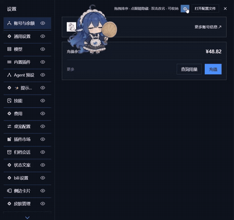

# dsh-settings-nav-manager

> **DSH 设置页导航管理插件** —— 给设置页左侧分区导航加上「**拖拽排序 · 显隐 · 抽屉收纳**」，一键进入编辑模式随手整理，自动持久保存。

适用于 [DeepSeek Harness（DSH）](https://github.com/deepseek-ai/deepseek-harness) 的 `web`（网页版）与 `desktop`（桌面版）两个 profile。纯 JavaScript / ESM，**无需构建**。

---

## 产品演示



---

## 功能特性

| 功能 | 说明 |
|---|---|
| **⚙ 编辑模式** | 设置弹窗标题栏「打开配置文件」左侧新增齿轮。点击进入编辑模式，再点或 `Escape` 退出。齿轮常驻防死锁；编辑模式是临时态，不持久化。 |
| **⇣ 拖拽排序** | 编辑模式下按住条目整行拖动即可排序，实时预览插入位置，松手定序并立即保存。位移阈值 > 6px 判定为拖拽，低于阈值按普通点击放行，**不误触发导航跳转**。拖拽被中断（窗口失焦、触屏手势被系统接管）会自动回滚，不会卡住。 |
| **👁 显隐开关** | 点眼睛切换。隐藏条目在编辑模式内仍可见（置灰 + 划线眼，方便一眼找到恢复入口），非编辑模式下 `display:none`。允许全部隐藏。若隐藏的正是当前浏览的分区，会自动切到第一个可见分区。 |
| **🗄 抽屉收纳** | 新建命名抽屉把条目收进去：**拖入 / 拖出 / 组内排序**，双击抽屉名改名（1–32 字符，可重名），点抽屉头任意位置折叠 / 展开，一键解散（成员回到未分组、保留顺序）。支持空抽屉。 |
| **└ L 型归属线** | 抽屉内条目左侧有 L 型树线，一眼看清条目挂在哪个抽屉下。 |
| **↺ 恢复默认** | 编辑模式底部一键清空抽屉与隐藏、回到宿主默认顺序。整理乱了不用怕。 |
| **⌨ 键盘操作** | 编辑模式下：`Alt+↑/↓` 移动条目（或抽屉），`h` 切换显隐，抽屉头上 `Enter` / `Space` 折叠、`F2` 改名，`Escape` 退出（在改名输入框内只取消改名）。 |
| **💬 即时说明** | 编辑模式下齿轮旁显示操作提示（拖拽排序 · 点眼睛隐藏 · 双击改名 · 可收纳），退出即隐藏。 |
| **💾 持久化** | 排序 / 显隐 / 抽屉结构写入 `settings-nav-manager` 命名空间，重启保留、切换语言重建后仍正确。读取异常一律回退默认，不报错；**写入失败会在齿轮旁提示并带上宿主给出的原因**，不再静默丢数据。 |

---

## 安装

> 安装命令参考社区插件（如 [dsh-purge](https://github.com/YuJunZhiXue/dsh-purge)、[dsh-market](https://github.com/dsh-market/dsh-market)）的通用写法。包名：`dsh-settings-nav-manager`（已发布到 [npm](https://www.npmjs.com/package/dsh-settings-nav-manager)）。

### 从 npm 安装（推荐）

**网页版（`dsh web`）：**

```sh
dsh plugin --profile web add dsh-settings-nav-manager
```

**桌面版（Desktop 桌面应用）：** `desktop` profile 由桌面应用独占管理，需先让应用初始化它：

1. 启动一次桌面应用（初始化 profile），然后**完全退出**；
2. 执行安装：

```sh
dsh plugin --profile desktop add dsh-settings-nav-manager
```

3. 重新打开桌面应用，进入 **设置** 使用。

安装后重启（网页版 `dsh web` / 桌面版重开应用），打开 **设置** 即可看到齿轮按钮。

### 从 GitHub 安装（tarball）

```sh
# 网页版
dsh plugin --profile web add github:ZIye1208/dsh-settings-nav-manager
# 桌面版
dsh plugin --profile desktop add github:ZIye1208/dsh-settings-nav-manager
```

或用压缩包直链：

```sh
dsh plugin --profile <web|desktop> add https://github.com/ZIye1208/dsh-settings-nav-manager/archive/refs/heads/main.tar.gz
```

### 本地 / 开发安装

```sh
git clone https://github.com/ZIye1208/dsh-settings-nav-manager.git
cd dsh-settings-nav-manager
dsh plugin --profile web add .        # 桌面版把 web 换成 desktop
```

开发时用 `link:` 软链指向本地目录，改 `client.js` 后重启 DSH 即生效，无需重装。

### 卸载

```sh
dsh plugin --profile <web|desktop> remove dsh-settings-nav-manager
```

---

## 使用说明

1. 打开 **设置**，点击标题栏「打开配置文件」左侧的 **⚙ 齿轮**进入编辑模式（齿轮高亮，齿轮旁出现操作提示）。
2. **排序**：按住任意条目整行上下拖动，实时预览位置，松手保存。也可聚焦某行后按 `Alt+↑/↓`。
3. **隐藏**：点条目右侧的 👁 眼睛（或聚焦该行按 `h`）；隐藏后条目置灰、眼睛变划线眼，再点恢复；非编辑模式下直接不显示。
4. **抽屉**：
   - 点底部「＋ 新建抽屉」创建并立即改名；
   - 拖条目到抽屉名**入组**，拖到抽屉外**出组**，组内可继续排序；
   - 点抽屉头任意位置**折叠 / 展开**收纳（`▾` / `▸`）；
   - **双击**抽屉名改名，点 `×` **解散**（成员回未分组、保序）。
5. **恢复默认**：点底部「恢复默认」清空所有整理，回到宿主原始顺序。
6. 按 `Escape` 或再点齿轮**退出**编辑模式。所有改动即时持久化，重启保留。

---

## 数据结构与持久化

数据存放在 DSH 设置命名空间 **`settings-nav-manager`**，形状如下：

```json
{
  "version": 1,
  "order": ["general", "g-1", "models", "plugins"],
  "groups": [
    { "id": "g-1", "name": "常用", "collapsed": false, "items": ["account", "skills"] }
  ],
  "hidden": ["bili-settings"]
}
```

- `order`：顶层相对顺序，元素为**未分组的分区 id** 或**抽屉 id（`g-` 前缀）**。
- `groups[]`：抽屉（命名分组）：`id` / `name` / `collapsed`（收纳折叠）/ `items`（组内成员 id，有序）。
- `hidden`：被隐藏的分区 id 数组。

写入前过滤非法元素；读取任何异常一律回退默认值，不报错。

> **命名空间必须等于插件条目 id。** 宿主的 `settings.update()` 用 `entries().find(row => row.options.id === ns)` 定位配置项，两者不一致会抛 `No configurable plugin entry`。本仓库的 `cordis.patch.yml` 把条目 id 固定为 `settings-nav-manager`，与 `client.js` 的 `NS` 常量一致；改动任一处都会被 `test/repo.test.mjs` 拦住。

---

## 分区识别

分区 id 取 `settings.section` 槽条目的 `options.id`。导航行（navCell）本身不带 id，靠标题文本与 `options.label` 匹配映射（DOM 序号为主、文本为兜底），因此**切换界面语言后仍能正确认行**。

识别采用双向校验：序号映射要求文本一致（或尚未渲染），并对重复 id 做保护；一旦发现行数与分区数不一致、且文本无法唯一对应，**本次不重排**并在齿轮旁提示「导航结构变化」，而不是硬认错行把顺序写坏。

## 实现约束（React 安全）

- 不改写 React 管理的 nav DOM 结构（`replaceWith` / `removeChild` 会抛 `NotFoundError`）；只加 `data-*` 属性 + 注入 CSS（图标用伪元素 / 描线 SVG mask 绘制，随主题取色）。
- 排序用 CSS `order` 重排，不动 React 节点（nav 容器为 flex column）。
- 抽屉头是插件自有 DOM 节点，配合 `MutationObserver` 自愈重建。
- 观察范围刻意收窄：面板是 `createPortal` 到 `document.body` 的直接子节点，因此只监听 body 的直接 `childList`（感知开关）+ nav 自身（感知行变化），并用 `requestAnimationFrame` 合并同帧回调；**不订阅整个文档子树**，避免流式输出时被 DOM 变更拖慢。
- 拖拽基于起手快照重算（纯函数），`pointercancel` / 失焦 / 页面隐藏都会回滚，不留半截状态。
- 选择器收敛到 `client.js` 头部的 `SEL` / `DATA` 常量表，宿主升级断链只改那一处；**不把 id 拼进选择器**（id 里的引号会让 `querySelector` 抛错），改用属性遍历比对。

## 开发与测试

```sh
npm test          # 纯逻辑单测 + 仓库校验（秒级，无需浏览器）
npm run test:e2e  # 无头 Chrome 端到端（真实 DOM + 真实 PointerEvent）
npm run locale    # 由 client.js 的字典重新生成 locale/*.json
```

- `test/unit.test.mjs`：`normalize` / `serialize` / `applyDropTo` / `nudgeState` 等纯函数，包含 1.0.1 那个数据丢失缺陷的回归用例（「分区未知时不得裁剪」）。
- `test/repo.test.mjs`：清单声明（`platform` 必须是 `web`、命名空间必须等于条目 id、兼容范围要有上界）、文案单一来源、源码卫生（无 `innerHTML` / `eval`、无选择器拼接）。
- `test/e2e.mjs`：用无头 Chrome 复刻宿主设置页 DOM + 最小 React 运行时，按出厂方式加载 `client.js`，真实驱动指针 / 键盘事件；同时跑 `git HEAD` 的旧版本做 **A/B 对照**——标注「旧版应失败」的断言若在旧版通过，测试会判定为无效并失败。

## 排障

| 现象 | 处理 |
|---|---|
| 打开设置看不到齿轮 | 确认插件装在**当前 profile**（`web` 还是 `desktop`），装完需重启/重开应用；齿轮挂在 `settings.action` 槽，若被其他插件挤占可临时停用对方排查。 |
| 齿轮旁出现「未能保存排版（…）」 | 括号里是宿主的原始拒绝原因。插件会依次尝试 `update` / `replace` / `mutate` 三条写入口，全都失败才提示；控制台 `[settings-nav-manager]` 有每一条的完整错误。常见原因见上方「数据结构与持久化」。 |
| 齿轮旁出现「导航结构变化，暂未应用整理」 | 认行失配（行数与 `settings.section` 条目对不上）。通常是刚装了新插件、分区还在注册中；关掉重开设置即可。若持续出现，请在 issue 里附上你的分区列表。 |
| 整理后重启又变回去了 | 1.0.0 的已知缺陷，升级到 **1.0.1** 即可。 |
| 想彻底重置 | 编辑模式底部点「恢复默认」，或删除设置文档里 `settings-nav-manager` 命名空间的 `user` 段。 |

## 兼容性

| 项 | 值 |
|---|---|
| DSH | `>=0.2.1-rc.2 <0.3.0`（`web` / `desktop` profile，实测 0.2.1-rc.2） |
| 运行时 | Node ≥ 20.18 |
| 构建 | 无（纯 JS / ESM） |

> `package.json` 里的 `dsh.client.platform` 必须写 **`"web"`**——宿主的模块系统据此判定「这是浏览器侧包」，桌面版同样读这个值（`platform !== "web"` 会被直接忽略）。别改成 `"desktop"`。

## 项目结构

```
dsh-settings-nav-manager/
├── index.js           # Host 侧：settings 命名空间 Config（volatile）声明
├── client.js          # Client 侧：齿轮 / 编辑模式 / DOM 干预 / 拖拽 / 显隐 / 抽屉 / 持久化
├── cordis.patch.yml   # 插件注册（id = settings-nav-manager）
├── locale/            # zh.json / en.json（由 client.js 字典生成）
├── icon.svg           # 插件图标
├── assets/demo.gif    # 产品演示动图
├── tools/gen-locale.mjs
└── test/              # unit / repo / e2e（含 harness）
```

## 许可

MIT
